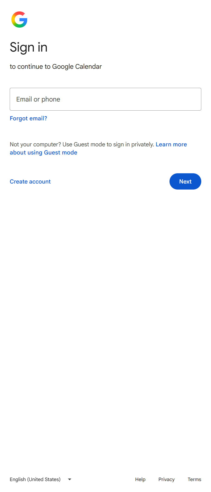

# Dock Web Calendar

A PowerToys Command Palette extension that puts today's date on the Dock and, when you click it, opens Google Calendar itself in a panel on the right of the screen. The panel is a single WebView2 (Edge engine) window that sits against the right edge and fills the screen from top to bottom, like the macOS Notification Centre.

It is the simpler sibling of [DockCalendar](https://github.com/heesup/DockCalendar). Instead of drawing its own calendar it shows the Google Calendar web app, so there is no OAuth client to set up, and everything the web app can do works, including adding, editing and deleting events.

## Screenshot

The panel on first run, before signing in. It is docked to the right edge and as tall as the screen's work area.



## Install

Requirements: Windows 11, PowerToys Command Palette 0.9 or newer with the Dock enabled, and the .NET 10 SDK (`10.0.401` or later). The WebView2 runtime ships with Windows 11.

```powershell
./build-and-install.ps1
```

Then add the **Dock Web Calendar** band under Command Palette **Settings → Dock → Bands**.

## Use

- Click the band to open the panel. The first time, it shows the Google sign-in form; after one sign-in you stay signed in.
- To close it, click outside the panel or click the band again. While a Google sign-in page is showing, the panel stays open when it loses focus, so a passkey prompt, password manager or code app does not interrupt the sign-in; close it with the band or `Alt+F4`.
- Views are switched with Google Calendar's own shortcuts: `M` month, `W` week, `D` day, `A` schedule, `T` today. Google remembers the view you used last.
- Once created, the panel is kept when closed, so it reopens at once on the page as you left it.
- Links that want a new window, such as a Meet call or an attachment, open in your default browser.
- Drag the panel's left edge to resize it; the width is remembered. The default width is the narrowest at which Google Calendar's desktop page both fits across (about 1040 pixels) and fills the panel from top to bottom. A narrower panel still fills the height, and Google Calendar switches to its own compact layout: fewer header buttons, no side menu button, and a week grid that scrolls sideways. The Day view (`D`) suits a narrow panel best.

## Run without Command Palette

```powershell
dotnet run --project DockWebCalendar -c Release -- --pin
```

`--pin` keeps the panel open when it loses focus.

## Good to know

- `calendar.google.com` refuses to be embedded in an iframe (X-Frame-Options), so the WebView2 navigates to it directly instead.
- The sign-in (cookies) is stored in `%LocalAppData%\DockWebCalendar\WebView2`, separate from Edge and Chrome. To sign out, sign out of the Google account inside the panel or delete that folder.
- Google sometimes blocks sign-in from embedded browsers as "not secure". WebView2 usually passes, but that is up to Google's policy.
- The WebView2 processes start the first time the panel opens and stay in memory while Command Palette is running.

## License

[PolyForm Noncommercial License 1.0.0](LICENSE.md). You may use, modify and redistribute this software for any noncommercial purpose, as long as you pass on the license terms and the notice below. Commercial use is not permitted. This is a source-available license, not an OSI-approved open source one.

> Required Notice: Copyright (c) 2026 Heesup Yun (https://github.com/heesup/DockWebCalendar)

Parts adapted from other projects are listed in [THIRD_PARTY_NOTICES.md](THIRD_PARTY_NOTICES.md).
